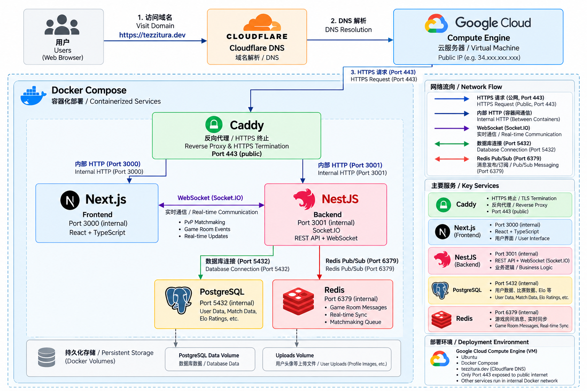

# Tezzitura 项目简介 / Tezzitura Project Overview

Tezzitura 是一款面向音乐学习者的在线听音训练 Web 应用，提供结构化听音练习、实时 PvP 匹配、好友对战、Elo 排名和训练数据统计等功能。我主要负责或参与了项目中的多人实时功能、后端业务逻辑以及生产环境部署。

Tezzitura is an online ear-training web application for music learners, featuring structured listening exercises, real-time PvP matchmaking, friend matches, Elo ranking, and training statistics. My primary contributions focused on real-time multiplayer functionality, backend business logic, and production deployment.

## 在线演示 / Live Demo

https://tezzitura.dev

---

## 精选代码 / Selected Code Samples

`selected-code/` 目录包含我在原项目中负责或参与实现的部分代表性代码摘录。

The `selected-code/` directory contains representative excerpts from the original project code that I contributed to.

---

## 项目截图 / Screenshots

项目截图将展示在 `screenshots/` 目录中。

---

## 部署架构 / Deployment Architecture

下图展示了 Tezzitura 在生产环境中的主要服务组成、网络流向与数据存储结构。

The diagram below shows the main production services, network flow, and persistent storage architecture of Tezzitura.

---

## 说明 / Repository Note

本仓库用于求职和个人作品展示。

This repository is intended for portfolio and recruiting purposes.

由于 Tezzitura 原项目为团队协作开发项目，本仓库不会公开完整项目源码，仅展示我负责或参与开发的部分代表性代码摘录、项目说明、架构和截图。

Because the original Tezzitura application was developed as a team project, this repository does not contain the complete project source code. It only includes selected excerpts from code I contributed to, along with project documentation, architecture, and screenshots.

精选代码文件保持原项目实现逻辑，仅进行必要的片段截取和展示说明。

The selected code samples preserve the implementation logic of the original project and are presented as excerpts for portfolio purposes.
